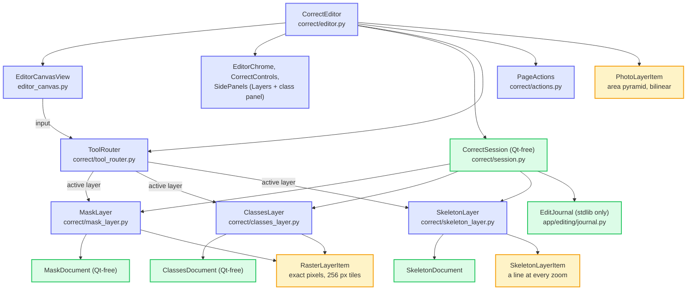

# Root-Mask-and-Skeletons (SPROUTS): Architecture

SPROUTS is a PyQt6 desktop application for plant-root phenotyping from minirhizotron
images. A ResNet model predicts a root mask (area) and a Pix2Pix model predicts a root
skeleton (length), both from the original image. The user corrects the predictions on one
canvas, Measure writes the CSVs, and Plotly Dash dashboards chart them.

### Key Capabilities
- **One Correct editor with three layers**: mask, skeleton and class labels of an image on
  one canvas, one layer edited at a time, one undo timeline. Every human save goes to the
  project's `gt/` folder (`gt/mask/<stem>.png`, `gt/skeletons/<stem>.png`, `gt/<stem>.png`).
- **Two model branches**: ResNet for masks and Pix2Pix for skeletons. The skeletonizer never
  reads masks, so a mask correction changes area only.
- **Measure reads GT first** (`app/inference/measure_sources.py`): the GT file where it is
  valid, else the prediction. The last CSV column, `Source`, says which.
- **Calibrated output**: the field of view is 18 x 13.5 mm by default and can be set per
  project in `sprouts_project.json` (`app/calibration.py`); length uses the corner-count
  estimator (Vossepoel and Smeulders, 1982) in `app/inference/metrics.py`.
- **Reproducible batches**: fixed batch shapes by default (`SPROUTS_BATCH_POLICY=fixed`),
  and a provenance sidecar next to every CSV.
- **Dashboards**: Dash/Plotly length and area dashboards embedded in the window.

The five stages are Library, Generate, Correct, Measure and Visualize (`Alt+1` to `Alt+5`).

---

## The Correct editor (composition)

One stage edits the documents of an image on one canvas. `CorrectEditor`
(`app/gui/correct/editor.py`) owns no document, tool or history logic: it builds the parts
below, forwards the `MainWindow` API (`load_image`, `maybe_save_changes`, `reset`,
`navigate`, ...) and turns the session's save reports into signals (`mask_saved`,
`mask_cleared`, `skeleton_saved`, `skeleton_cleared`, `gt_saved`).



- **Layers** implement one contract, `EditLayer` (`app/gui/correct/layer.py`): open, save
  and revert, their own undo stack, gestures, tools, visibility and opacity. The layer ids
  are `MASK`, `SKELETON` and `CLASSES`. `MaskLayer` and `ClassesLayer` are both
  `RasterLayer`s (`raster_layer.py`: canvas, Brush / Eraser / Fill, history replay) over
  their own Qt-free document; `SkeletonLayer` has its own tools (`app/gui/skeleton_tools.py`).
- **The session** (`CorrectSession`) opens the layers, aggregates the unsaved state, saves
  (the unsaved layers; with nothing unsaved, nothing is written), asks the one Save /
  Discard / Cancel question (`app/gui/editor_prompts.py`) and keeps one undo timeline:
  `EditJournal` records which layer acted, each layer keeps its own stack. `save_gate.py`
  asks before a save would replace a file the layer could not load, and `stamps.py` notices
  files that changed on disk.
- **What each layer reads and writes**: the mask opens `gt/mask/<stem>.png`, else the
  prediction `mask/<stem>.png`; the skeleton opens `gt/skeletons/<stem>.png`, else the
  prediction; the class labels open `gt/<stem>.png` with the registry `gt/classes.json`
  (`app/gt/`). A save never writes `mask/` or `skeletons/`. A mask or skeleton equal to its
  prediction removes its GT file.
- **Paging**: after each open, `paging.Neighbours` asks the library for the next and
  previous images and the Qt-free `read_ahead.ReadAhead` reads them on one worker thread
  (photo, mask plane, thinned skeleton; at most 3 images and 256 MiB; used only while the
  files' stamps still match). `read_back.py` hands the image just left back to the read-ahead.
- **Small parts**: `keys.py` (the page's shortcut table), `chip.py` (the status chip),
  `layer_prefs.py` (layer opacity and visibility in QSettings), `actions.py` (Load skeleton
  file, Load prediction, Classes, Remove GT).
- The shared canvas parts are `EditorCanvasView`, `EditorChrome`, `PaintCanvas`
  (`app/gui/paint_canvas.py`) and the render items in `app/gui/canvas_layers/`.
- Every `app/gui/correct/*.py` stays at or under 450 lines (a ratchet test).

---

## Data flow

1. The GUI process starts a job: `app/handlers/*` build a `GuardedThread` (error boundary
   and cancel, `app/workers.py`) and `JobRegistry` runs one batch job at a time.
2. `app/inference/batch_engine.py` runs the batches for both models: decode on a thread
   pool, the GPU forward on the job's thread, PNG writes on an async writer. Fixed batch
   shapes keep outputs identical from run to run; `runtime.py` picks device and precision.
3. `mask_inference.py` writes `mask/<stem>.png`; `skeleton_inference.py` writes
   `skeletons/<stem>_fake.png`. The user corrects in Correct; saves go to `gt/`.
4. `measure_sources.py` picks GT or prediction per image; `metrics.py` computes length (mm)
   and area (mm2) with the project's field of view; `measure_run.py` writes
   `skeletons/root_lengths.csv` and `mask/root_areas.csv` with a provenance sidecar.
5. `app/visualization/` reads the CSVs through `app/data_processing/` and serves the
   dashboards on `127.0.0.1:8050` (length) and `127.0.0.1:8051` (area), embedded by
   `QWebEngineView`.

The README "Pipeline" diagram is the picture.

---

## File Structure & Artifacts

### Directory Structure

```
Root-Mask-and-Skeletons/
├── main.py                       # Entry point: start-up flags, theme, MainWindow
├── app/
│   ├── config.py, calibration.py # Constants (ports, folder names, FOV); per-project FOV
│   ├── project_layout.py, naming.py, io_utils.py, provenance.py, models.py, user_paths.py
│   ├── enhancement.py, feedback.py, workers.py, gc_policy.py, logging_config.py
│   ├── qt_environment.py         # Qt / Chromium start-up flags per OS (Qt-free)
│   ├── design/tokens.py          # SPROUTS design tokens
│   ├── editing/                  # Undo history, journal, geometry, thinning
│   ├── imaging/pyramid.py        # Image pyramid of smooth zoom
│   ├── masks/store.py            # Mask store
│   ├── gt/                       # Class labels: registry, store, files, dataset export
│   ├── mask_model/model.py       # Mask segmentation network
│   ├── inference/                # batch_engine, mask_inference, skeleton_inference, metrics,
│   │                             # measure_sources, measure_run, runtime, device_probe, ...
│   ├── handlers/                 # Batch jobs: mask / skeleton generation, JobRegistry
│   ├── data_processing/          # CSV processing and MeasurementIndex
│   ├── visualization/            # Dash length and area dashboards, QWebEngineView windows
│   └── gui/
│       ├── main_window.py        # MainWindow, composed from the parts in window/
│       ├── window/               # navigator, project_loader, metrics, editors, stages,
│       │                         # job_buttons, lifecycle, body
│       ├── correct/              # The Correct stage (see above)
│       ├── canvas_layers/        # Photo, raster and skeleton render items
│       ├── widgets/              # Buttons, overlays, toasts, icons, tokens re-export
│       ├── display_controller.py, library_index.py, shell_chrome.py, shortcuts.py, ...
│       ├── editor_canvas.py, editor_chrome.py, paint_canvas.py, editor_prompts.py
│       └── skeleton_document.py (SkeletonFiles), skeleton_tools.py, skeleton_graph_model.py
├── resources/themes/dark_theme.qss
├── scripts/                      # fetch_models.py, make_examples.py, build scripts
├── tests/                        # Test suite (offscreen Qt)
├── docs/                         # This file, DATA_DICTIONARY, MODELS, KNOWN_ISSUES, examples/
└── <project>/                    # A user's project folder, next to the images
    ├── mask/<stem>.png           # Predicted masks (Generate)
    ├── mask/root_areas.csv       # Root area per mask
    ├── skeletons/<stem>_fake.png # Predicted skeletons (Generate)
    ├── skeletons/root_lengths.csv# Root length per skeleton
    ├── gt/mask/, gt/skeletons/   # GT saved in Correct
    ├── gt/<stem>.png             # Class labels; gt/classes.json is the registry
    └── sprouts_project.json      # Optional per-project field of view
```

### Runtime Artifacts

| Artifact | Location | Format | Description |
|----------|----------|--------|-------------|
| Input images | User specified | PNG/JPG | Original root images |
| Predicted masks | `mask/<stem>.png` | 8-bit PNG | ResNet output (Generate) |
| Predicted skeletons | `skeletons/<stem>_fake.png` | PNG | Pix2Pix output (Generate) |
| GT masks | `gt/mask/<stem>.png` | PNG | Saved in Correct after an edit |
| GT skeletons | `gt/skeletons/<stem>.png` | 8-bit PNG | Saved in Correct after an edit |
| Class labels | `gt/<stem>.png` | 8-bit palette PNG | Saved in Correct; id 255 is Ignore |
| Length CSV | `skeletons/root_lengths.csv` | CSV | Root length (mm), with a `Source` column |
| Area CSV | `mask/root_areas.csv` | CSV | Root area (mm2), with a `Source` column |
| Dash servers | `127.0.0.1:8050`, `:8051` | Web | Length and area dashboards (`app/config.py`) |

For the module map see CLAUDE.md; for formats see docs/DATA_DICTIONARY.md.
